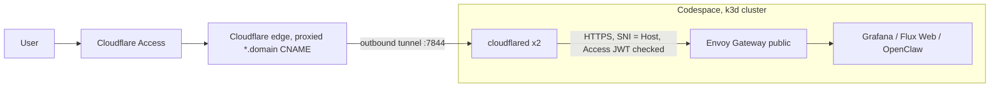

# GitOps AI template — Flux CD 2 composition

This repository is a **Flux CD 2.x** GitOps template. It separates **reusable workload packages** from **per-cluster composition** and uses **Kustomize**, **Helm** (via Flux’s Helm controller), and **SOPS** for secrets.

## High-level architecture

1. **Flux installation** — A `FluxInstance` ([`flux-instance.yaml`](flux-instance.yaml)) pins the **Flux 2.x** distribution, enables core controllers (source, kustomize, helm, notification), and turns on **NetworkPolicy** for Flux’s own namespace. Git sync is declared to apply the path `clusters/${CLUSTER_NAME}` from your Git repository.
2. **Cluster root** — Each cluster directory (see [`clusters/_template/`](clusters/_template/)) is a Kustomize package whose only resource is the **`cluster-components`** Flux `Kustomization`.
3. **Workload bundle** — That Flux `Kustomization` reconciles `./clusters/<cluster-name>/components`: shared charts, ingress, certificates, DNS, monitoring, and optional apps. It **prunes** removed objects and decrypts **SOPS**-encrypted files using the `sops-age` secret.

So: **GitRepository → (bootstrap applies) `clusters/<name>` → Flux `Kustomization` → `clusters/<name>/components` → merged manifests** (templates + cluster secrets).

## Directory layout (rules)

| Area                                                                          | Role                                                                                                                                                                                                                                                                                            |
|-------------------------------------------------------------------------------|-------------------------------------------------------------------------------------------------------------------------------------------------------------------------------------------------------------------------------------------------------------------------------------------------|
| [`flux-instance.yaml`](flux-instance.yaml)                                    | Declarative Flux 2 install and Git sync path; uses placeholders for repo URL, branch, and cluster name.                                                                                                                                                                                         |
| [`clusters/_template/`](clusters/_template/)                                  | **Skeleton** for a new cluster: copy to `clusters/<your-cluster>/` and replace template values.                                                                                                                                                                                                 |
| [`clusters/<name>/kustomization.yaml`](clusters/_template/kustomization.yaml) | Kubernetes **Kustomization** that lists only [`cluster-sync.yaml`](clusters/_template/cluster-sync.yaml) (the Flux `Kustomization` manifest).                                                                                                                                                   |
| [`clusters/<name>/components/`](clusters/_template/components/)               | **Composition layer**: small Kustomize packages that **include** pieces from `templates/` and add **cluster-only** resources (for example SOPS secrets). Order and dependencies are controlled by the root [`components/kustomization.yaml`](clusters/_template/components/kustomization.yaml). |
| [`templates/`](templates/)                                                    | **Reusable** Kustomize packages (namespaces, `HelmRepository`, `HelmRelease`, extra manifests). **Do not** put environment-specific secrets here; keep them under `clusters/.../components/`.                                                                                                   |

## Flux `Kustomization`: `cluster-components`

[`clusters/_template/cluster-sync.yaml`](clusters/_template/cluster-sync.yaml) defines the main Flux `Kustomization`:

- **Path**: `./clusters/${CLUSTER_NAME}/components`
- **Prune**: `true` (removed Git objects are removed from the cluster)
- **Decryption**: SOPS with `secretRef.name: sops-age`
- **Post-build substitution** (`postBuild.substitute`): replaces tokens in rendered YAML before apply. Keys are fixed and must match what you use in manifests (for example `${cluster_domain}` in Helm values).

Substituted keys in this template include: `cluster_name`, `cluster_domain`, `cluster_public_ip`, `letsencrypt_email`, `ingress_nginx_allowed_ips`, and the optional `letsencrypt_server` (defaults to the Let's Encrypt production directory; the bootstrapper sets the staging URL on request). **Render** this file with `envsubst` (or your bootstrap tooling) so `${CLUSTER_NAME}` and related placeholders in the **Flux `Kustomization` spec** itself are resolved; Helm values and other YAML often use the **`postBuild`** keys (for example `${cluster_domain}`) without a shell `envsubst` step.

## Templates: how to structure a package

Under `templates/`, group workloads by concern (`system/`, `monitoring/`, `dashboards/`, `storage/`, `ai/`, `homelab/`, etc.). A typical app folder contains:

- `kustomization.yaml` — lists resources; sets `namespace:` when the app runs in a dedicated namespace.
- `namespace.yaml` — when the workload needs its own namespace.
- `helm-repository-*.yaml` — `HelmRepository` in the same namespace as the `HelmRelease` (or `flux-system` for shared repos—follow existing patterns in that subtree).
- `helm-release-*.yaml` — `HelmRelease` with `apiVersion: helm.toolkit.fluxcd.io/v2`, pinned chart `version`, and `interval` for reconciliation.

Reference [`kustomizeconfig.yaml`](kustomizeconfig.yaml) from template kustomizations that need Kustomize to **rewrite** `spec.valuesFrom` names when you use `namePrefix`/`nameSuffix` (HelmRelease → ConfigMap/Secret name references).

**Sources**: Prefer `HelmRepository` for Helm charts. Some bundles use **`OCIRepository`** for OCI-hosted charts (for example [`templates/system/flux-web/oci-repository.yaml`](templates/system/flux-web/oci-repository.yaml)).

**Operator custom resources**: when a CRD is installed by a `HelmRelease` in the same Flux `Kustomization`, a plain CR fails the server-side dry-run on first apply. Wrap the CR in the shared `additional-manifests` chart and add `dependsOn` on the operator release (see [`templates/monitoring/grafana-operator/helm-release-grafana-instance.yaml`](templates/monitoring/grafana-operator/helm-release-grafana-instance.yaml) and [`templates/ai/openclaw-instance/helm-release-openclaw-instance.yaml`](templates/ai/openclaw-instance/helm-release-openclaw-instance.yaml)).

## Cluster components: composition rules

- **One folder per concern** under `clusters/<name>/components/<component>/`, with a `kustomization.yaml` that:
  - **`resources:`** includes the path to the matching **`templates/...`** package (relative path like `../../../../templates/system/cert-manager`).
  - Adds **cluster-specific** files next to it (for example `secret-cloudflare.yaml`, `secret-openclaw-envs.yaml`) — these should be **SOPS-encrypted** in real repos, not plain secrets.
- **Do not** fork entire `templates/` into a cluster dir for small tweaks; extend via patches or extra manifests in `components/` so upstream template updates stay mergeable.

The **order** of entries in [`clusters/_template/components/kustomization.yaml`](clusters/_template/components/kustomization.yaml) matters: shared Helm repos and CRDs are listed before components that depend on them (for example Prometheus Operator CRDs before stacks that assume those CRDs exist).

**Opt-in components** ship a folder under `clusters/_template/components/` but are **not** listed in that `kustomization.yaml`, so bootstrappers that do not know them never apply unrendered placeholders. The bootstrapper inserts them when selected; CI appends them before validation. Currently: [`cloudflare-tunnel`](clusters/_template/components/cloudflare-tunnel/).

## Security conventions

- **Secrets**: Store provider API tokens and similar data as **SOPS**-encrypted manifests under `clusters/.../components/`, referenced by `decryption` in the Flux `Kustomization`. Do not commit raw credentials.
- **Flux**: The template enables **network policies** on the Flux installation via `FluxInstance` (`networkPolicy: true`). Keep Flux and Helm release namespaces aligned with least-privilege RBAC from upstream charts.
- **Helm**: Pin chart versions in `HelmRelease` specs; use explicit `interval` and chart `version` fields suitable for your change cadence.
- **Supply chain**: When upstream signs its OCI charts, enable `spec.verify` (cosign keyless with `matchOIDCIdentity`) on the `OCIRepository` (for example [`templates/ai/openclaw-operator/oci-repository-openclaw-operator.yaml`](templates/ai/openclaw-operator/oci-repository-openclaw-operator.yaml)).

## Versioning and metadata

- [`template-sync-metadata.yaml`](template-sync-metadata.yaml) holds the template **semver** and upstream pointer; bump it when you cut releases, in line with [`CHANGELOG.md`](CHANGELOG.md) and git tags.

## Running in GitHub Codespaces

The [`.devcontainer`](.devcontainer/devcontainer.json) runs the whole stack on a free GitHub Codespace (k3d in Docker-in-Docker) and publishes it on your own domain through the [`cloudflare-tunnel`](templates/system/cloudflare-tunnel/) component: no public IP or inbound port, and every app is behind Cloudflare Access.

**Limits of the free tier** (personal accounts): 120 core-hours per month, so about 30 hours on the required 4-core / 16 GB machine. A codespace stops after at most 240 minutes without user activity (a running cluster does not count), and the site is down while it is stopped. Docker data survives stop/start and `post-start.sh` restarts the cluster; deleting the codespace deletes the cluster, but Git plus the age key let you bootstrap it again. Use it for development and demos, not as permanent hosting.

**One-time setup**

1. Create your repo from this template, and keep the domain on Cloudflare (use the zone apex as cluster domain; Universal SSL covers one subdomain level only).
2. Enable [Cloudflare Zero Trust](https://one.dash.cloudflare.com) (Free plan) and create two API tokens:
   - **runtime** (stored SOPS-encrypted for cert-manager): `Zone > DNS > Edit`, `Zone > Zone > Read`;
   - **setup** (used once, never stored, revoke afterwards): `Account > Cloudflare Tunnel > Edit`, `Account > Access: Apps and Policies > Edit`, `Account > Access: Organizations, Identity Providers, and Groups > Read`, `Zone > DNS > Edit`.
3. Add [Codespaces secrets](https://github.com/settings/codespaces) scoped to your repo: `GITOPS_GIT_TOKEN` (fine-grained PAT, this repo only, Contents read/write), optionally `GITOPS_FLUX_GIT_TOKEN` (Contents read-only, used by Flux instead), `CLOUDFLARE_API_TOKEN`, `CLOUDFLARE_SETUP_TOKEN`.
4. In the same settings page, set the idle timeout to 240 minutes.

**Bootstrap**

1. Open a 4-core codespace on your repo and run `npx gitops-ai bootstrap`. It detects Codespaces, uses k3d, takes the repo from the codespace and defaults to the **Cloudflare Tunnel** network mode.
2. Save the age key outside the codespace: `gh secret set SOPS_AGE_KEY --user --repos <owner>/<repo> < ~/.sops/age.agekey`. `post-start.sh` restores it on every start.
3. Open `https://grafana.<domain>` and sign in with an allowed email.

**Security notes**

- Nothing is forwarded through `*.app.github.dev` (`onAutoForward: ignore`); public traffic only enters through the tunnel.
- The Gateway allowlist is the pod CIDR `10.42.0.0/16`, and the `cloudflared` NetworkPolicy allows egress only to kube-dns, the Envoy proxies (container port 10443) and public IPs on 7844.
- GitHub's terms allow Codespaces for development; do not use Actions runners to host a long-running service.

## CI expectations

Pipelines (for example [`.gitlab-ci.yml`](.gitlab-ci.yml) and [`.github/workflows/ci.yml`](.github/workflows/ci.yml)) **copy** `clusters/_template` to a temporary cluster name, **`envsubst`** `cluster-sync.yaml`, enable the opt-in components, then run **`flux build kustomization`** and **`kubeconform`** against the built manifests. Changes that break Kustomize layout or Flux API shapes should fail CI.

## Adding a new workload (checklist)

1. Add a reusable package under `templates/<area>/<app>/` (namespace, repos, `HelmRelease`, optional extra YAML).
2. Add `clusters/_template/components/<app>/kustomization.yaml` that references the template and any optional secrets.
3. Append the new component to `clusters/_template/components/kustomization.yaml` in the **correct dependency order**.
4. Use `postBuild` variable names already wired in `cluster-sync.yaml`, or extend that file’s `substitute` map consistently and document new keys.
5. Run the same **build + kubeconform** flow locally or rely on CI.

---

This README describes the **composition rules** encoded in this repo. For Flux’s own behavior (APIs, health checks, dependencies), refer to the [Flux documentation](https://fluxcd.io/flux/) for your pinned Flux 2 version.
